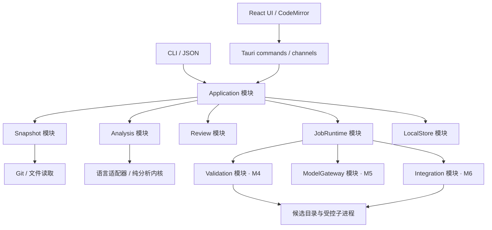
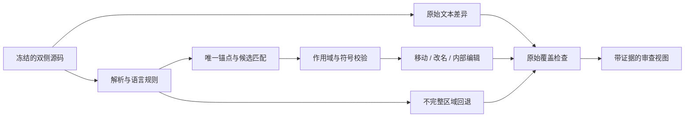
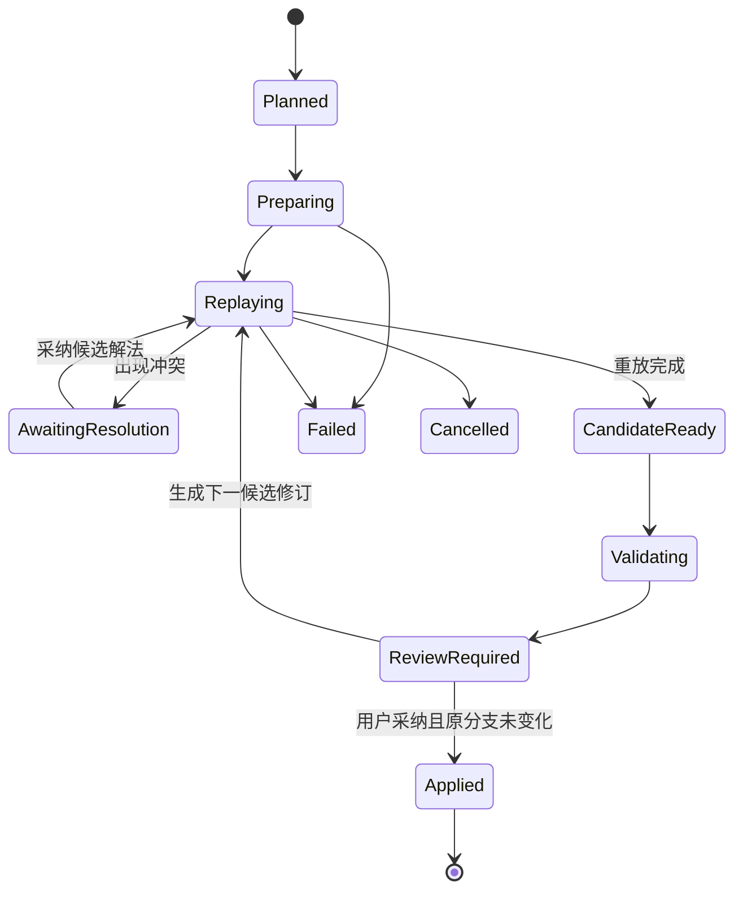

# Diffkin 整体架构

日期：2026-10-28。状态：建议方案，待 M0 原型验证。

Diffkin 采用本地桌面应用和可独立调用的 Rust 内核。中心对象是绑定源码快照的 `ChangeSet`：文本比较、结构关系、风险引导、验证和整合候选都消费同一份事实。默认界面只呈现当前比较，高成本能力按需开启。

## 1 产品范围与取舍

原讨论确定的方向是：开源免费、轻量高性能客户端、格式降噪、移动与内部修改、改名归组、多语言、多仓库联合对比、AI 风险引导，以及后续自动 rebase 解冲突并验证。

本方案新增的实施假设是：macOS 优先发布；JS/TS 优先、Vue 分层接入；一名熟悉 Rust / React 的全职开发者；首版只读。上述假设用于排定交付顺序，不代表已确认的平台或人员承诺。

| 范围         | 交付目标                                                                                                      |
| ------------ | ------------------------------------------------------------------------------------------------------------- |
| v0.1 必须有  | 本地 Git 比较、双栏/统一 diff、原始视图、保守格式折叠、文件内移动、有限局部改名、Vue SFC 分块、取消与文本回退 |
| 后续主要能力 | 多仓库会话与契约关联、独立验证、AI 审查引导、整合候选与自动解冲突、更多语言                                   |
| 暂不建设     | 通用 IDE、完整 Git GUI、云端协作后台、托管模型服务、插件市场、任意语言的行为等价证明                          |

基础比较、多仓库审查和验证结果查看保持免费；外部模型费用由用户选择的服务决定。许可证建议在 M0 确定，确定前不把任何许可证写成已采用。

## 2 技术选择

| 位置         | 选择                                  | 理由与验证点                                                          |
| ------------ | ------------------------------------- | --------------------------------------------------------------------- |
| 桌面壳       | Tauri 2                               | 复用系统 WebView；M0 测量真实安装体积、冷启动和滚动                   |
| UI           | React + TypeScript + Rsbuild/Rspack   | 贴合已有能力；按功能组织；状态库仅管理会话与 UI 状态                  |
| 代码显示     | CodeMirror 6 的 EditorView 与必要扩展 | 只读优先；自己实现 diff 对齐与关系层，M0 验证折叠、选择、搜索和长文档 |
| 内核         | Rust workspace                        | 纯分析逻辑与文件系统/进程操作分开；桌面与 CLI 共用                    |
| 解析         | Tree-sitter + 编译期语言适配器        | 先复用解析基础，自行维护归一化、匹配和证据规则                        |
| Git          | 系统 Git 子进程，由 Rust 封装         | 第一阶段减少 Git 行为重实现；缺失或版本不兼容时明确诊断               |
| 本地状态     | SQLite + 有上限的内容寻址缓存         | 审查状态事务化；大源码、日志和可重建结果分离                          |
| 后台任务     | 有界 CPU 工作池 + 异步 I/O            | 可取消、可限流、当前文件优先；不在 UI 或异步 I/O 线程执行重计算       |
| 项目符号分析 | 后期可选独立进程                      | 按需启用；基础包不附带完整 Node/JVM/语言服务运行时                    |
| AI           | Rust 侧供应商适配器                   | 密钥不进入 WebView；结构化结果统一验证；不绑定单一供应商              |

Tauri 使用 Rust 与 WebView 组合；这支持控制分发成本，但性能仍取决于实现。[Tauri 架构](https://v2.tauri.app/concept/architecture/) Windows 若附带 WebView2 离线运行时，需另计下载和安装成本。[Windows 分发](https://v2.tauri.app/distribute/windows-installer/)

CodeMirror 的模块化和视口渲染适合作为评估起点；视口渲染不会自动消除整份文档的内存成本。[官方指南源码](https://github.com/codemirror/website/blob/main/site/docs/guide/index.md) 其 GitHub 开发仓库已迁移，依赖维护应跟随官方给出的新上游。[上游迁移说明](https://github.com/codemirror/dev)

自有 `ChangeEvent` 是产品契约。Difftastic 可作为结构比较的基准对照，M0 评估可复用算法或代码与许可后再决定；不把它的终端输出当成内部协议。[Difftastic](https://github.com/Wilfred/difftastic)

## 3 运行结构与模块接口



每个模块通过小接口隐藏完整流程；先以 crate 内的 Rust module 实现，不为每个名词创建独立包。`Domain` 不依赖 Tauri、Git、SQLite、HTTP 或 UI。桌面与 CLI 调用相同的 `Application` 接口。

| Module       | 调用方看到的 Interface                                           | 内部承担的复杂度                                                 |
| ------------ | ---------------------------------------------------------------- | ---------------------------------------------------------------- |
| Snapshot     | `capture(spec) -> SnapshotManifest`；`read(sourceRef)`           | Git 对象/索引/工作区读取、内容冻结、路径编码、文件类型、变动检测 |
| Analysis     | `compare(frozenPair, options, budget, cancel) -> AnalysisResult` | 原始差异、语法、匹配、归组、覆盖检查与降级；不直接读取活动工作区 |
| Review       | `recordDecision(subject, basis, decision)`；`query(changeSet)`   | 审查状态、证据关联、按分析版本失效                               |
| JobRuntime   | `submit(request)`；`cancel(jobId)`；`observe(jobId)`             | 调度、优先级、取消、限额、进度、进程退出                         |
| LocalStore   | `loadSession(id)`；`commitRevision(revision)`                    | SQLite 事务、迁移、缓存引用、恢复与回收                          |
| Validation   | `run(plan, snapshot, policy) -> ValidationRun`                   | 候选装配、依赖身份核验、检查执行、日志与结果溯源                 |
| ModelGateway | `analyze(contextBundle, policy) -> FindingDraft[]`               | 提供商协议、流式输出、预算、引用校验；不授予仓库写权限           |
| Integration  | `prepare(plan)`；`resume(attemptId, action)`                     | 重放、冲突候选、提交映射、检查点、失败恢复与最终应用             |

表中的接口是语义契约草案，不是已经发布的 API。失败统一采用可判别错误：`unsupported`、`stale`、`cancelled`、`budget-exceeded`、`permission-denied`、`io-failure`；可部分完成的分析另附状态与回退区域。

生产默认只有 WebView、Rust 宿主及按需 Git 子进程。解析/匹配在宿主的有界后台池运行；若 M0 发现某个解析器无法在预算内协作取消，则把该任务放进可终止的分析子进程。取消 future 不等于终止 CPU 工作，不能用丢弃结果替代资源释放。

## 4 统一数据模型

### 4.1 身份与生命周期

| 对象                 | 最少保存的事实                                                  | 生命周期                                         |
| -------------------- | --------------------------------------------------------------- | ------------------------------------------------ |
| `Workspace`          | 本地仓库 ID、显示名、路径映射、显式关系                         | 可编辑；不是源码版本                             |
| `RepoSnapshot`       | 仓库 ID、来源、提交/树 ID、覆盖文件内容摘要、文件模式、捕获时间 | 内容不可变；Git OID 保留算法标识，不假设固定长度 |
| `WorkspaceSnapshot`  | 有序仓库快照清单、依赖装配声明、内容摘要                        | 不可变；各仓库有各自版本                         |
| `ChangeSet`          | 前后 WorkspaceSnapshot、比较模式、纳入/排除规则                 | 固定的比较输入；刷新生成新修订                   |
| `AnalysisRevision`   | ChangeSet ID、内核/语法/规则版本、选项摘要、覆盖范围            | 每次完整或部分分析的依据                         |
| `RawEdit`            | 双侧原始范围或文件元数据变化、文本操作类型                      | 不受降噪设置影响                                 |
| `ChangeEvent`        | 组合变化、子事件、RawEdit 引用、证据与审查标记                  | 绑定 AnalysisRevision                            |
| `Relation`           | 双侧实体/事件、关系类型、来源、依据                             | 区分语法匹配、契约、用户声明和模型假设           |
| `Finding`            | 事实、假设、影响、代码引用、建议检查、人工状态                  | 绑定快照、分析修订和上下文摘要                   |
| `ValidationRun`      | 目标快照、计划、实际依赖与工具版本、环境、结果、日志摘要        | 不可变执行记录；重跑创建新记录                   |
| `IntegrationAttempt` | 原始系列、目标提交、候选快照、提交映射、操作日志                | 带检查点的状态机                                 |

未修改的仓库也可作为上下文进入快照。跨仓库没有共同 `HEAD`；相同路径在不同仓库不能碰撞。源码引用由仓库、快照、路径和内容摘要共同定位。

### 4.2 事件与原始覆盖

```ts
// 概念模型；实际 DTO 以 Rust 定义生成，避免手工维护两套协议。
type SourceSpan = {
  repoId: string;
  snapshotId: string;
  pathId: string;
  contentId: string;
  byteStart: number; // 原始字节，含起点、不含终点
  byteEnd: number;
};

type ChangeEvent = {
  id: string;
  analysisRevisionId: string;
  facets: Array<"insert" | "delete" | "edit" | "move" | "rename" | "format">;
  before: SourceSpan[];
  after: SourceSpan[];
  children: string[];
  rawEditIds: string[];
  evidence: Array<{
    kind: "syntax-matched" | "local-symbol-confirmed" | "project-symbol-confirmed" | "heuristic";
    ruleId: string;
    ruleVersion: string;
  }>;
  reviewFlags: string[]; // scope/order/public-api/binding/parse 等
};

type CoverageEntry = {
  rawEditId: string;
  presentation:
    | { kind: "visible"; eventIds: string[] }
    | { kind: "folded-format"; proofIds: string[] }
    | { kind: "text-fallback"; reason: string };
};
```

`RawEdit` 细化到能够分别归属的原子范围。一个原子编辑只有一种覆盖处置，可被多个关联事件引用；父子事件和移动/改名标签不能重复增加变更计数。格式折叠必须有可检查的规则记录，启发式匹配不能作为折叠依据。覆盖缺口或非法范围会阻止发布该结构结果，整段或整文件回退。

解析器使用的原始字节坐标在内核统一；向 CodeMirror 的 UTF-16 坐标转换由位置索引负责。CRLF、BOM、中文、emoji 与组合字符必须保持双向定位；归一化结果只参与分析，不能替换原始源码。非 UTF-8 或无法无损映射的文件先进入明确标注的文本/二进制回退，不做结构折叠。

事件 ID 只在所属分析修订内有效。新版可以依据实体与内容锚点建议迁移审查记录，但默认标为待确认，不能仅按路径和行号继承“已审查”。

## 5 快照与 Git 比较语义

| 用户入口      | 实际比较                                                                |
| ------------- | ----------------------------------------------------------------------- |
| 两个提交/标签 | 两个解析后的提交树                                                      |
| 分支改动      | 显式选择直接比较，或 `merge-base(base, head)` 与 head；界面展示实际基线 |
| 已暂存        | HEAD 与冻结的 index                                                     |
| 未暂存        | 冻结的 index 与工作区捕获                                               |
| 全部本地改动  | HEAD 与工作区捕获；未跟踪文件由用户选择纳入                             |

多 merge-base、浅克隆缺历史、未出生 HEAD 或未解决的 index 冲突有明确状态；不能悄悄换成另一个比较模式。v0.1 不提供冲突编辑器，对未解决冲突先展示状态与原始内容。

提交树按不可变 Git 对象读取，活动分支名在创建比较时解析。工作区以基树加文件覆盖层冻结；先读取清单，再复制变化文件，读前读后检查身份、长度、时间和内容；发布清单前复核变更清单。检测到持续变化则重试有限次数并标记 `unstable`，不把部分读取标成完整快照。

文件系统捕获和多个仓库之间没有全局原子快照保证。清单保存每个捕获窗口；用户需要严格一致性时先固定提交。即使源文件随后变化，已捕获内容仍可复核；增量刷新必须建立新快照。未捕获的工作区依赖不能在后续分析时从活动文件补读后冒充旧快照，需扩展为新快照。

Git Adapter 使用参数数组调用程序和 NUL 分隔的机器格式；关闭外部 diff/textconv，避免路径与分支名被解释为 shell。只读命令使用 `GIT_OPTIONAL_LOCKS=0` 并避免 index refresh 等写操作。工作区原始字节与 Git blob 的换行/过滤差异明确保留，不自动执行仓库自定义 clean/smudge 过滤器。符号链接按链接对象比较，不沿链接读取仓库外文件。二进制、文件模式、Git LFS 指针和子模块提交变化均保留为可见事件；不在普通打开操作中下载 LFS 内容或递归拉取子模块。

只读适配器还应禁用仓库配置的可执行扩展（如 fsmonitor hook），按字面路径处理 pathspec；冻结 Git 对象时禁用 replacement refs 和 partial clone 的按需拉取，缺失对象明确报告，由用户另行获取。M0 检测所需选项的版本支持，不支持时不能静默退回可能执行脚本或联网的读取方式。Git 提供 optional-locks、literal-pathspecs、replace-objects 和 lazy-fetch 的相应控制。[Git 命令控制](https://git-scm.com/docs/git)

## 6 分析流水线



1. **文本基线。** 先获得完整原始编辑和位置索引，优先显示当前文件。采用成熟文本 diff 算法；比较算法和版本进入结果身份。
2. **解析与归一化。** 同时保留语法节点、关键 token、注释和原始位置。只有明确通过语言规则的 trivia 或括号变化才能折叠；指令注释、字符串、模板空白和未知区域默认可见。
3. **确定性锚点。** 用节点类型、结构指纹和唯一性建立候选，指纹命中后核对内容，不能把哈希相同直接当作语义等价。
4. **有限候选匹配。** 依据上下文、父节点、兄弟顺序、参数形状和已有锚点打分；限制每实体候选数量与总预算，避免全仓库节点两两比较。歧义保留普通增删。
5. **移动与内部编辑。** 匹配实体后继续递归比较。父节点/文件/相对顺序变化才构成移动依据；前方插入导致的行号平移不算移动。旧位置保留时标为新增或复制候选。
6. **局部改名。** 在两个版本分别解析作用域和绑定，校验声明及对应引用。引用增删另记；遮蔽、解构、属性简写、导出、动态访问等不支持情形保留文本或标记待确认。
7. **归组与覆盖。** 一个函数可同时包含 move、rename、edit；父事件下保留条件、常量、调用等子编辑。覆盖检查通过后才发布结构结果。

Tree-sitter 提供具体语法树，named 与 anonymous 节点都可能含有必须保留的信息；不能只比较 named nodes。[Tree-sitter 解析模型](https://tree-sitter.github.io/tree-sitter/using-parsers/2-basic-parsing.html) 语法对应关系也不等于编译器级符号解析。[Tree-sitter 定位](https://tree-sitter.github.io/tree-sitter/)

默认采用保守折叠策略；不存在跨语言的“删除所有空格/括号”通道。Python 块归属、JS 自动分号插入、可选链边界、Rust 宏 token、Vue 模板文本等都进入反例语料。局部改名先服务于归组与导航，公共名称和绑定变化保持可见。

Vue 以容器处理：块标签及 `lang/scoped/module/src/setup` 属性单独比较，各子语言保留到 SFC 原文的映射。v0.1 支持可靠分块和脚本分析；模板/样式未支持的部分回退文本。M0 评估容器 grammar 的错误恢复，开发期可用官方编译器输出作为对照，避免为分块而在产品中强制携带 Node。跨 script/template 的绑定、`v-for` 与 slot 局部作用域在后续专门实现。[Vue SFC 规范](https://vuejs.org/api/sfc-spec.html)

## 7 调度与前后端协议

`Application` 负责创建比较、分页列出文件、获取指定文件结果和提交任务。Tauri command 处理请求/响应，channel 传递进度与结果引用；CLI 直接调用同一用例，输出带版本的 JSON。Tauri 官方将 channel 用于流式数据传递。[通信机制](https://v2.tauri.app/develop/calling-rust/)

| 请求                                      | 返回与行为                                         |
| ----------------------------------------- | -------------------------------------------------- |
| `open_comparison(spec)`                   | 快照捕获任务与 comparison ID；就绪事件后可查询文件 |
| `list_changes(id, cursor, limit)`         | 分页摘要，不包含全部文件源码                       |
| `request_file(id, fileId, detail)`        | 文本结果或分析 job ID；命中缓存时直接返回结果引用  |
| `get_result(resultId, section, cursor)`   | 按批读取源码/映射/事件；大文件分段                 |
| `cancel_job(jobId)`                       | 幂等取消请求；另发终态，说明是否已释放资源         |
| `record_review(subject, basis, decision)` | 检查版本后写入审查记录；过期请求返回 stale         |

所有消息包含 `schemaVersion`、comparison ID、输入 generation、job ID 和递增序号。结果引用携带 AnalysisRevision ID。UI 只接纳当前 generation 的消息；channel 中断后可查询任务与结果状态，不能依赖瞬时事件恢复会话。Rust 类型生成 TS DTO，并在跨进程入口做运行时校验。

优先级为：当前文件文本 → 当前文件结构 → 用户请求的关联内容 → 少量相邻文件预取 → 整仓扫描。切换文件取消无人订阅的预取；相同输入去重，共用任务时释放一个订阅不取消其他调用方。

CPU 分析并发初值为 `min(2, 可用核心数)`，随后按实测调整。每个循环、候选批次和解析入口检查取消/预算。语法树留在 Rust，只向 UI 发送源码引用、紧凑范围、关系与证据摘要。大文件先提供摘要和有界文本窗口；不将整棵 AST 序列化到 WebView。

UI 先显示原始文本，再增加结构标记。以源码锚点保存视口与选区，已有阅读位置在分析完成时保持稳定；新的折叠在安全位置更新，必要时提供“结构结果已就绪”入口，避免突然重排。

## 8 客户端交互

```text
┌ 仓库 / 比较版本                         原始·结构  检查风险 ┐
│ 文件 / 变更组 │ 双栏或统一 diff                         │
│               │ 代码、变化范围、当前选中的移动关系       │
│               │                                       │
├───────────────┴───────────────────────────────────────┤
│ 分析状态 / 格式折叠数 / 回退说明 / 按需展开的任务进度      │
└───────────────────────────────────────────────────────┘
  右侧详情栏仅在选择关系、风险或验证结果时出现
```

默认进入上次比较或“打开仓库”，无需先配置工作台。首版支持只读选择、复制、搜索、上下一个变更、文件跳转和键盘操作。搜索必须覆盖折叠内容，命中后自动展开；复制来自原始源码。

双栏对齐由原始映射和结构关系共同构建；CodeMirror 负责文本呈现，不再独立计算一套作为事实来源的 diff。统一视图使用同一数据。只为选中关系绘制连线，屏幕外目标用方向和跳转入口表示；查看移动内部修改时提供局部并排比较。颜色之外显示文字标签，尊重系统字体缩放、主题和减少动画设置。

文件树同时显示分析等级与状态：文本、语法、局部符号、项目符号；处理中、部分完成、回退和失败可区分。格式折叠数是可展开的审查信息，不把“隐藏很多行”作为主要成功指标。

## 9 多仓库、风险与验证

多仓库按三个阶段增加：M3 联合查看 → M5 有证据的关联 → M5/M6 联合验证与候选复核。UI 可按仓库或变更组导航；单仓库用户仍只看到一个仓库。

关系图先采用用户声明、依赖清单及 OpenAPI 等契约产生的具体边。每条边记录版本、来源、定位、关系类型和未解析条件。依赖了某个包不等于某行调用某个符号；同名字段也不等于协议兼容关系。M5 的首个自动关联切片选择 OpenAPI 与 TS 调用方，其他契约另行扩展。

`ContextBundle` 包含当前事件、有限双侧源码、已确认的关系、相关检查与缺失信息。ModelGateway 默认只在用户启动时执行，展示即将发送的仓库/文件范围与预算；忽略或私密路径可排除。云端与本地模型使用同一结果契约，基础能力不依赖它们。

模型输出 `FindingDraft`：观察事实、代码引用、推断前提、潜在影响、建议动作。宿主校验引用是否存在于该快照、结构是否符合 schema，再生成 Finding；缺证据时显示为假设或拒收。严重度、证据充分度、验证状态分开呈现；按共同根因去重，记录上下文截断。源码中的文字是分析数据，不是工具执行指令。

验证模块独立于模型。验证计划包含可执行程序、参数数组、工作目录、环境策略、超时、网络需求和依赖装配方式。用户审阅具体计划后执行；已授权的固定检查可复用授权，但项目配置或模型文字不能自行扩大可执行范围。

每次验证先在候选目录装配冻结内容，记录实际解析到的包、锁文件、local override、容器镜像摘要或本机工具版本，并核验候选源码是否真的被使用。前端仍链接发布版 SDK 时，不能声称已验证本次 SDK 候选。执行前后核验纳入检查的源码身份，测试若改写源码则结果不再标为原快照通过。

验证结果分为 `passed / failed / inconclusive / cancelled / not-run`，附带执行范围、退出码和日志；环境未启动不是代码测试失败。历史失败需要基线对照才能判断是否为新回归。改变源码、配置、依赖装配或相关分析依据后，旧结果只作为历史记录。

## 10 rebase 与自动解冲突

M6 才实现自动整合。首个实验范围限定为单仓库、线性提交系列、干净输入；merge commit、复杂子模块和跨仓库同时改写留待后续。算法可以更换，但以下状态与产物先固定：



其他运行态也可失败或取消；验证失败仍保留可审查候选，不自动转成 Applied。重试创建新候选修订，历史验证不覆写。

候选在工具管理的独立目录生成；Git worktree 可用于可信本地仓库的隔离工作目录，但共享仓库的部分元数据和 refs，不能当作安全沙箱。[Git worktree](https://git-scm.com/docs/git-worktree) 不可信项目执行检查需要额外隔离；容器是可选执行 Adapter，不是普通查看的前提。

同时保留原系列、目标基线、候选系列及原提交到新提交的映射。审查要比较“原始 base→原始 head”与“目标 base→候选 head”的改动，并区分重放和冲突处理新增的变化。`git range-diff` 仅作为给人看的辅助证据；官方明确其输出不适合机器稳定解析。[Git range-diff](https://git-scm.com/docs/git-range-diff)

先展示候选结构 diff、风险、检查结果和未覆盖项，再由用户采纳。M6 首版采纳为新候选分支；覆盖已有分支作为后续显式操作，更新前验证目标 ref 仍为计划记录值，检查相关工作区状态，使用带旧值校验的更新流程。若目标分支在其他 worktree 中检出，不直接更新 ref，避免源码/index 与 HEAD 不一致；不自动 force push。每个破坏性步骤前落盘检查点，记录备份 ref 和恢复信息；取消保留可恢复候选，删除仅限工具拥有且状态已核验的目录。

## 11 存储、权限与恢复

SQLite 保存 workspace、会话修订、审查状态、任务和结果索引；BlobStore 保存冻结内容、大结果与日志。用户设置与源码缓存分开；应用数据目录由各平台标准位置解析。仓库内可选配置只保存可共享的关系和验证计划，不写入本机密钥与绝对路径。

缓存键至少含双侧内容摘要、语言/grammar/规则/引擎版本、比较选项；符号结果额外包含双侧项目配置与依赖摘要，模型结果额外包含模型、提示模板和上下文摘要。派生缓存可丢弃重建；被已保存审查引用的快照是持久证据，不能被普通 LRU 淘汰。磁盘达到限额时提示清理或停止新捕获，不能静默破坏已保存结果。

保存审查时，将证据引用的源码和必要清单复制到 BlobStore，并记录已归档范围；只保存 Git OID 不能保证对象在仓库 GC 后仍然存在。未归档的历史上下文若已不可读取，显示缺失并要求新输入，不能拿当前工作区内容补齐旧证据。

使用单写入协调与 SQLite 事务；迁移先备份元数据，写入临时内容后原子登记引用。启动时把未结束任务标记为 interrupted，重新验证候选目录后提供继续/清理；不自动恢复任意命令或模型请求。缓存索引损坏时允许重建，审查记录使用备份恢复。

WebView 只获得已选工作区的句柄，Rust 再验证实际路径、内容身份与操作权限；不暴露任意 shell 命令入口。打包 UI 使用 CSP 和最小 Tauri capabilities，不加载可调用本地命令的远程页面。[Tauri capabilities](https://v2.tauri.app/security/capabilities/) 密钥放系统凭据存储；日志默认不含完整源码、模型密钥或请求正文。遥测默认关闭，诊断导出由用户发起并可预览。

## 12 建议代码组织

下列是目标结构；已实现 desktop、cli、domain、analysis、application 和 protocol。Git workspace、storage 及后续模块尚未创建：

```text
apps/
  desktop/
    src/features/{comparison,review,settings}/
    src/components/diff-view/
    src-tauri/                 # 薄命令桥接与平台能力
  cli/                         # Rust 命令行入口
crates/
  domain/                      # IDs、快照、事件、任务与 DTO
  analysis/                    # 文本/结构算法、语言规则、覆盖检查
  workspace/                   # Git Adapter、冻结内容、位置索引
  application/                 # 用例、调度、审查；后续 validation/integration
  storage/                     # SQLite、BlobStore、迁移
packages/
  protocol/                    # 生成的 TS DTO 与协议样例
fixtures/
  correctness/                 # 语言与组合变化真值语料
  repositories/                # 小型可重复构建的 Git 历史
benchmarks/                    # 场景清单、生成器、原始报告
docs/
  architecture.md
  roadmap.md
  quality.md
```

M0 只创建实际需要的包。M4/M5/M6 到来时，若验证、模型或整合模块的依赖和生命周期需要独立管理，再拆 crate。暂不做常驻 daemon、HTTP 内核服务、动态 ABI、通用事件总线或语言插件商店。

Cargo workspace 管理 Rust，pnpm workspace 管理前端与生成契约；锁定工具链和依赖。模块 Interface 与真实 fixture 是测试入口；用内存源码和 Git 源码两个实际 Adapter 验证 Snapshot seam，不为每个内部函数引入可替换抽象。
