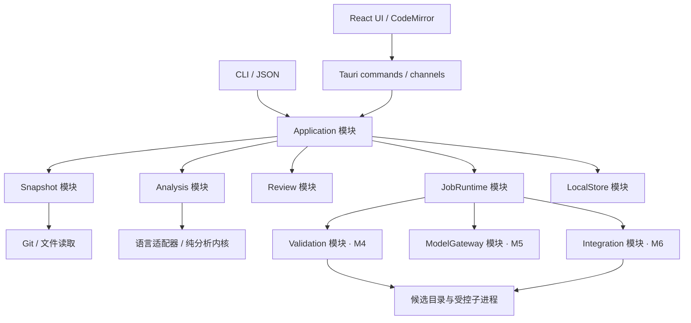
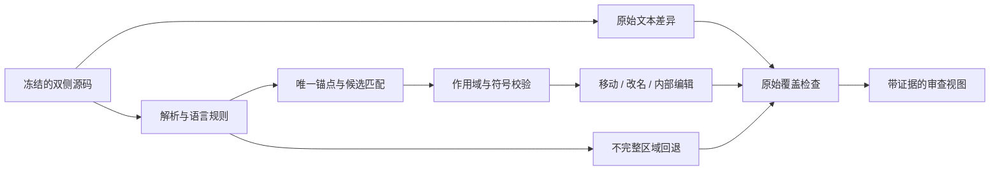
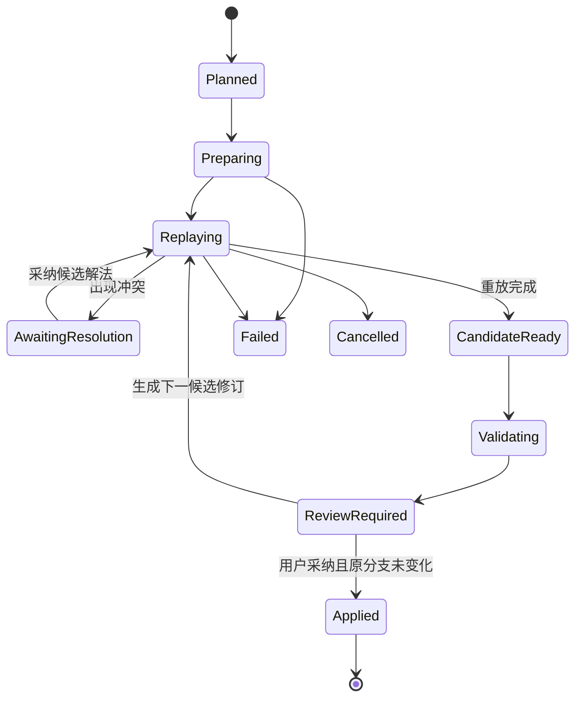

# Diffkin 整体架构

日期：2026-10-28。状态：**0.3.0-alpha.0，M3/M4 实现与后续演进方案**。当前交付包括多语言结构 diff、多仓库冻结审查和单仓固定提交的可信本机验证；实际范围见 [M3/M4 验收记录](acceptance/m3-m4.md)。SQLite、项目符号、AI、自动契约与整合仍是未来设计；原生 UI 和产品门槛未全部验收。

Diffkin 采用本地桌面应用和可独立调用的 Rust 内核。目标中心对象是绑定源码快照的 `ChangeSet`。当前审查使用 `FrozenComparison` / `FrozenWorkspace`；M4 独立从固定 commit 装配完整提交树，记录自己的源码与命令身份，不把 M3 的变化文件集合当成可执行的完整候选。后续风险与整合将复用这些可追溯事实。默认界面只呈现当前比较，高成本能力按需开启。

## 1 产品范围与取舍

原讨论确定的方向是：开源免费、轻量高性能客户端、格式降噪、移动与内部修改、改名归组、多语言、多仓库联合对比、AI 风险引导，以及后续自动 rebase 解冲突并验证。

本方案新增的实施假设是：macOS 优先发布；JS/TS 优先、Vue 分层接入；一名熟悉 Rust / React 的全职开发者；首版只读。上述假设用于排定交付顺序，不代表已确认的平台或人员承诺。

| 范围         | 交付目标                                                                                                      |
| ------------ | ------------------------------------------------------------------------------------------------------------- |
| v0.1 必须有  | 本地 Git 比较、双栏/统一 diff、原始视图、保守格式折叠、文件内移动、有限局部改名、Vue SFC 分块、取消与文本回退 |
| 当前增量     | 多仓库会话、手工关系、持久证据；Unix 单仓固定提交验证与基线对照                                               |
| 后续主要能力 | 自动契约关联与依赖装配、AI 审查引导、整合候选与自动解冲突、更多语言                                           |
| 暂不建设     | 通用 IDE、完整 Git GUI、云端协作后台、托管模型服务、插件市场、任意语言的行为等价证明                          |

基础比较、多仓库审查和验证结果查看保持免费；外部模型费用由用户选择的服务决定。项目已采用 [MIT 许可证](../LICENSE)，第三方依赖保留各自许可证。

## 2 技术选择

| 位置         | 选择                                         | 理由与验证点                                                                 |
| ------------ | -------------------------------------------- | ---------------------------------------------------------------------------- |
| 桌面壳       | Tauri 2                                      | 复用系统 WebView；M0 测量真实安装体积、冷启动和滚动                          |
| UI           | React + TypeScript + Rsbuild/Rspack          | 贴合已有能力；按功能组织；状态库仅管理会话与 UI 状态                         |
| 代码显示     | CodeMirror 6 的 EditorView 与必要扩展        | 只读优先；自己实现 diff 对齐与关系层，M0 验证折叠、选择、搜索和长文档        |
| 内核         | Rust workspace                               | 纯分析逻辑与文件系统/进程操作分开；桌面与 CLI 共用                           |
| 解析         | Tree-sitter + 编译期语言适配器               | 先复用解析基础，自行维护归一化、匹配和证据规则                               |
| Git          | 系统 Git 子进程，由 Rust 封装                | 第一阶段减少 Git 行为重实现；缺失或版本不兼容时明确诊断                      |
| 本地状态     | 当前有界 JSON；SQLite / BlobStore 为后续方向 | 工作区原子归档；验证计划、完整副本和日志独立保存，现阶段人工管理验证保留空间 |
| 后台任务     | blocking worker、独立有界入口与取消 token    | 单仓捕获/分析、多仓存储、验证使用各自 gate；退出锁住新任务并取消等待既有任务 |
| 项目符号分析 | 后期可选独立进程                             | 按需启用；基础包不附带完整 Node/JVM/语言服务运行时                           |
| AI           | Rust 侧供应商适配器                          | 密钥不进入 WebView；结构化结果统一验证；不绑定单一供应商                     |

Tauri 使用 Rust 与 WebView 组合；这支持控制分发成本，但性能仍取决于实现。[Tauri 架构](https://v2.tauri.app/concept/architecture/) Windows 若附带 WebView2 离线运行时，需另计下载和安装成本。[Windows 分发](https://v2.tauri.app/distribute/windows-installer/)

CodeMirror 的模块化和视口渲染适合作为评估起点；视口渲染不会自动消除整份文档的内存成本。[官方指南源码](https://github.com/codemirror/website/blob/main/site/docs/guide/index.md) 其 GitHub 开发仓库已迁移，依赖维护应跟随官方给出的新上游。[上游迁移说明](https://github.com/codemirror/dev)

自有 `ChangeEvent` 是产品契约。Difftastic 可作为结构比较的基准对照，M0 评估可复用算法或代码与许可后再决定；不把它的终端输出当成内部协议。[Difftastic](https://github.com/Wilfred/difftastic)

## 3 运行结构与模块接口



每个模块通过小接口隐藏完整流程；按实际依赖和生命周期拆分，M4 已成为独立 `validation` crate，Git 与工作区存储仍在 `application` 内。`Domain` 不依赖 Tauri、Git、SQLite、HTTP 或 UI。桌面与 CLI 调用相同的 `Application` 接口。

| Module       | 调用方看到的 Interface                                                | 内部承担的复杂度                                                 |
| ------------ | --------------------------------------------------------------------- | ---------------------------------------------------------------- |
| Snapshot     | `capture(spec) -> SnapshotManifest`；`read(sourceRef)`                | Git 对象/索引/工作区读取、内容冻结、路径编码、文件类型、变动检测 |
| Analysis     | `compare(frozenPair, options, budget, cancel) -> AnalysisResult`      | 原始差异、语法、匹配、归组、覆盖检查与降级；不直接读取活动工作区 |
| Review       | `recordDecision(subject, basis, decision)`；`query(changeSet)`        | 审查状态、证据关联、按分析版本失效                               |
| JobRuntime   | `submit(request)`；`cancel(jobId)`；`observe(jobId)`                  | 调度、优先级、取消、限额、进度、进程退出                         |
| LocalStore   | `WorkspaceStore::{load,capture,restore,set_review,add_relation}`      | 有界 JSON、原子替换、依据校验、历史保留与损坏拒绝                |
| Validation   | `prepare(spec,store,cancel)`；`run(store,plan_id,target,cancel,emit)` | 完整提交装配、可信本机进程、日志与结果；实际依赖装配仍未确认     |
| ModelGateway | `analyze(contextBundle, policy) -> FindingDraft[]`                    | 提供商协议、流式输出、预算、引用校验；不授予仓库写权限           |
| Integration  | `prepare(plan)`；`resume(attemptId, action)`                          | 重放、冲突候选、提交映射、检查点、失败恢复与最终应用             |

除列出的当前 Store/Validation 接口外，表中接口仍是语义契约草案；实际 DTO 由 Rust 生成，未承诺公共 API 稳定性。失败统一采用可判别错误：`unsupported`、`stale`、`cancelled`、`budget-exceeded`、`permission-denied`、`io-failure`；可部分完成的分析另附状态与回退区域。

普通比较只使用 WebView、Rust 宿主及按需 Git 子进程；明确确认验证计划后，宿主另启动计划指定的可信程序。解析/匹配在宿主的有界后台池运行；若 M0 发现某个解析器无法在预算内协作取消，则把该任务放进可终止的分析子进程。取消 future 不等于终止 CPU 工作，不能用丢弃结果替代资源释放。

## 4 统一数据模型

### 4.1 身份与生命周期

下表是跨阶段目标模型。当前 M3 的 `WorkspaceSnapshot` 是多个独立双侧比较的清单；`EvidenceBasis` 绑定工作区快照、仓库 ID、仓库比较 ID、文件 ID、双侧内容 ID、schema 和规则版本。M4 的 `ValidationPlan` / `ValidationResult` 则分别绑定完整提交源码与命令，不含已确认的跨仓依赖声明。

| 对象                 | 最少保存的事实                                                  | 生命周期                                         |
| -------------------- | --------------------------------------------------------------- | ------------------------------------------------ |
| `Workspace`          | 本地仓库 ID、显示名、路径映射、显式关系                         | 可编辑；不是源码版本                             |
| `RepoSnapshot`       | 仓库 ID、来源、提交/树 ID、覆盖文件内容摘要、文件模式、捕获时间 | 内容不可变；Git OID 保留算法标识，不假设固定长度 |
| `WorkspaceSnapshot`  | 有序仓库快照清单、依赖装配声明、内容摘要                        | 不可变；各仓库有各自版本                         |
| `ChangeSet`          | 前后 WorkspaceSnapshot、比较模式、纳入/排除规则                 | 固定的比较输入；刷新生成新修订                   |
| `AnalysisRevision`   | ChangeSet ID、内核/语法/规则版本、选项摘要、覆盖范围            | 每次完整或部分分析的依据                         |
| `RawEdit`            | 双侧原始范围或文件元数据变化、文本操作类型                      | 不受降噪设置影响                                 |
| `ChangeEvent`        | 组合变化、子事件、RawEdit 引用、证据与审查标记                  | 绑定 AnalysisRevision                            |
| `Relation`           | 双侧实体/事件、关系类型、来源、依据                             | 区分语法匹配、契约、用户声明和模型假设           |
| `Finding`            | 事实、假设、影响、代码引用、建议检查、人工状态                  | 绑定快照、分析修订和上下文摘要                   |
| `ValidationRun`      | 目标快照、计划、实际依赖与工具版本、环境、结果、日志摘要        | 不可变执行记录；重跑创建新记录                   |
| `IntegrationAttempt` | 原始系列、目标提交、候选快照、提交映射、操作日志                | 带检查点的状态机                                 |

未修改的仓库也可作为上下文进入 M3 快照，但当前只保存比较身份及零变化状态，不归档其所有未变化文件正文。M4 为执行检查另行捕获完整提交。跨仓库没有共同 `HEAD`；相同路径在不同仓库不能碰撞。源码引用由仓库、快照、路径和内容摘要共同定位。

### 4.2 事件与原始覆盖

```ts
// 概念模型；实际 DTO 以 Rust 定义生成，避免手工维护两套协议。
type SourceSpan = {
  repoId: string;
  snapshotId: string;
  pathId: string;
  contentId: string;
  byteStart: number; // 原始字节，含起点、不含终点
  byteEnd: number;
};

type ChangeEvent = {
  id: string;
  analysisRevisionId: string;
  facets: Array<"insert" | "delete" | "edit" | "move" | "rename" | "format">;
  before: SourceSpan[];
  after: SourceSpan[];
  children: string[];
  rawEditIds: string[];
  evidence: Array<{
    kind: "syntax-matched" | "local-symbol-confirmed" | "project-symbol-confirmed" | "heuristic";
    ruleId: string;
    ruleVersion: string;
  }>;
  reviewFlags: string[]; // scope/order/public-api/binding/parse 等
};

type CoverageEntry = {
  rawEditId: string;
  presentation:
    | { kind: "visible"; eventIds: string[] }
    | { kind: "folded-format"; proofIds: string[] }
    | { kind: "text-fallback"; reason: string };
};
```

`RawEdit` 细化到能够分别归属的原子范围。一个原子编辑只有一种覆盖处置，可被多个关联事件引用；父子事件和移动/改名标签不能重复增加变更计数。格式折叠必须有可检查的规则记录，启发式匹配不能作为折叠依据。覆盖缺口或非法范围会阻止发布该结构结果，整段或整文件回退。

解析器使用的原始字节坐标在内核统一；向 CodeMirror 的 UTF-16 坐标转换由位置索引负责。CRLF、BOM、中文、emoji 与组合字符必须保持双向定位；归一化结果只参与分析，不能替换原始源码。非 UTF-8 或无法无损映射的文件先进入明确标注的文本/二进制回退，不做结构折叠。

事件 ID 只在所属分析修订内有效。新版可以依据实体与内容锚点建议迁移审查记录，但默认标为待确认，不能仅按路径和行号继承“已审查”。

## 5 快照与 Git 比较语义

| 用户入口      | 实际比较                                                  |
| ------------- | --------------------------------------------------------- |
| 两个提交/标签 | 两个解析后的提交树                                        |
| 分支改动      | 当前作为两个 ref 的直接比较；自动 merge-base 模式留待后续 |
| 已暂存        | HEAD 与冻结的 index                                       |
| 未暂存        | 冻结的 index 与工作区捕获                                 |
| 全部本地改动  | HEAD 与工作区捕获；未跟踪文件由用户选择纳入               |

浅克隆缺历史、未出生 HEAD 或未解决的 index 冲突有明确状态；不能悄悄换成另一个比较模式。后续加入 merge-base 模式时，还需处理多个 merge-base 的歧义。v0.1 不提供冲突编辑器，对未解决冲突先展示状态与原始内容。

仓库导航独立提供有界的本地引用发现与原生目录选择，不拉取远程或修改检出状态。比较模式中的来源与目标可填写分支、标签或 commit ID，真正捕获时再固定对象身份。

工作区比较默认利用完整且非 racy 的 index/stat 元数据筛选候选，并流式扫描全仓元数据。未知转换与无法证明的 stat 条件保守读取正文；默认结果明确保留 stat 缓存依据。“完整原文核验”/`verifyAll` 则读取所有现存已跟踪文件的原始字节，用于核对历史转换遗留内容，继续受时间和冻结内容预算约束。Windows 缺少完整 stat 证明时保守走正文读取。

提交树按不可变 Git 对象读取，活动分支名在创建比较时解析。工作区以基树加文件覆盖层冻结；先读取清单，再复制变化文件，读前读后检查身份、长度、时间和内容；发布清单前复核变更清单。当前捕获检测到身份变化时返回 `stale`，由用户发起新捕获，不把部分读取标成完整快照。

文件系统捕获和多个仓库之间没有全局原子快照保证。清单保存已固定的各仓比较身份及工作区捕获时间；用户需要严格一致性时先固定提交。即使源文件随后变化，已捕获内容仍可复核；增量刷新必须建立新快照。未捕获的工作区依赖不能在后续分析时从活动文件补读后冒充旧快照，需扩展为新快照。

Git Adapter 使用参数数组调用程序和 NUL 分隔的机器格式；关闭外部 diff/textconv，避免路径与分支名被解释为 shell。只读命令使用 `GIT_OPTIONAL_LOCKS=0` 并避免 index refresh 等写操作。工作区原始字节与 Git blob 的换行/过滤差异明确保留，不自动执行仓库自定义 clean/smudge 过滤器。符号链接按链接对象比较，不沿链接读取仓库外文件。二进制、文件模式、Git LFS 指针和子模块提交变化均保留为可见事件；不在普通打开操作中下载 LFS 内容或递归拉取子模块。

只读适配器还应禁用仓库配置的可执行扩展（如 fsmonitor hook），按字面路径处理 pathspec；冻结 Git 对象时禁用 replacement refs 和 partial clone 的按需拉取，缺失对象明确报告，由用户另行获取。M0 检测所需选项的版本支持，不支持时不能静默退回可能执行脚本或联网的读取方式。Git 提供 optional-locks、literal-pathspecs、replace-objects 和 lazy-fetch 的相应控制。[Git 命令控制](https://git-scm.com/docs/git)

## 6 分析流水线



1. **文本基线。** 先获得完整原始编辑和位置索引，优先显示当前文件。采用成熟文本 diff 算法；比较算法和版本进入结果身份。
2. **解析与归一化。** 同时保留语法节点、关键 token、注释和原始位置。只有明确通过语言规则的 trivia 或括号变化才能折叠；指令注释、字符串、模板空白和未知区域默认可见。
3. **确定性锚点。** 用节点类型、结构指纹和唯一性建立候选，指纹命中后核对内容，不能把哈希相同直接当作语义等价。
4. **有限候选匹配。** 依据上下文、父节点、兄弟顺序、参数形状和已有锚点打分；限制每实体候选数量与总预算，避免全仓库节点两两比较。歧义保留普通增删。
5. **移动与内部编辑。** 匹配实体后继续递归比较。父节点/文件/相对顺序变化才构成移动依据；前方插入导致的行号平移不算移动。旧位置保留时标为新增或复制候选。
6. **局部改名。** 在两个版本分别解析作用域和绑定，校验声明及对应引用。引用增删另记；遮蔽、解构、属性简写、导出、动态访问等不支持情形保留文本或标记待确认。
7. **归组与覆盖。** 一个函数可同时包含 move、rename、edit；父事件下保留条件、常量、调用等子编辑。覆盖检查通过后才发布结构结果。

Tree-sitter 提供具体语法树，named 与 anonymous 节点都可能含有必须保留的信息；不能只比较 named nodes。[Tree-sitter 解析模型](https://tree-sitter.github.io/tree-sitter/using-parsers/2-basic-parsing.html) 语法对应关系也不等于编译器级符号解析。[Tree-sitter 定位](https://tree-sitter.github.io/tree-sitter/)

默认采用保守折叠策略；不存在跨语言的“删除所有空格/括号”通道。Python 块归属、JS 自动分号插入、可选链边界、Rust 宏 token、Vue 模板文本等都进入反例语料。局部改名先服务于归组与导航，公共名称和绑定变化保持可见。

Vue 以容器处理：块标签及 `lang/scoped/module/src/setup` 属性单独比较，各子语言保留到 SFC 原文的映射。v0.1 支持可靠分块和脚本分析；模板/样式未支持的部分回退文本。M0 评估容器 grammar 的错误恢复，开发期可用官方编译器输出作为对照，避免为分块而在产品中强制携带 Node。跨 script/template 的绑定、`v-for` 与 slot 局部作用域在后续专门实现。[Vue SFC 规范](https://vuejs.org/api/sfc-spec.html)

## 7 调度与前后端协议

Tauri 使用类型化 command 请求/响应；Rust DTO 生成 TypeScript。CPU、文件和进程工作在 blocking worker 运行，前端用 generation 隔离过期响应。现阶段不提供通用 daemon 或全局事件总线。

| 当前入口                                                      | 行为                                                            |
| ------------------------------------------------------------- | --------------------------------------------------------------- |
| `open_comparison` / `list_changes` / `request_file`           | 单仓捕获、每页最多 200 条、按需返回冻结文件与分析；保留原有语义 |
| `workspace_capture` / `workspace_restore`                     | 多仓捕获或恢复持久快照，并安装到 Runtime；不清除单仓快照        |
| `workspace_basis` / `workspace_review` / `workspace_relation` | 后端生成真实依据，再核对当前快照和规则后保存审查或手工关系      |
| `workspace_list` / `workspace_save` / `workspace_export`      | 配置和摘要管理；导出省略源码、本机路径及备注                    |
| `validation_prepare` / `validation_run`                       | 准备具体计划；确认后按计划 ID 运行候选或基线                    |
| 验证日志、计划、结果、历史查询                                | 有界增量分页与持久结果；丢失实时消息不等于丢失最终结果          |
| `cancel_job` / 验证取消                                       | token 传递到工作线程；真实子进程取消另由验证进程组实现          |

Runtime 最多保留 16 个活动作业、128 条提前取消记录和 8 个文件分析结果。捕获和分析 gate 避免同类重工作无限并发；workspace mutation 由独立 gate 与磁盘文件锁串行；验证有自己的计划锁。当前单仓快照与最近两个工作区快照共存；磁盘上的历史证据不受此内存缓存淘汰影响。

退出时设置 shutdown 门闩，拒绝新的作业，取消已有 token，并等待工作线程结束；取消 future 或丢弃迟到响应不被当作资源释放。解析/匹配循环检查取消和预算，语法树留在 Rust。验证日志当前通过有界分页轮询传递，序号连续、截断显式，并保留最终结果尾部。

通用优先级队列、跨调用订阅去重、项目符号进程和更细粒度结果分页是后续优化方向，不能从目标接口推导为当前已有功能。

## 8 客户端交互

下图保留目标布局；“检查风险”和风险详情属于尚未实现的 M5。当前新增入口是工作区与固定版本验证。

```text
┌ 仓库 / 比较版本                         原始·结构  检查风险 ┐
│ 文件 / 变更组 │ 双栏或统一 diff                         │
│               │ 代码、变化范围、当前选中的移动关系       │
│               │                                       │
├───────────────┴───────────────────────────────────────┤
│ 分析状态 / 格式折叠数 / 回退说明 / 按需展开的任务进度      │
└───────────────────────────────────────────────────────┘
  右侧详情栏仅在选择关系、风险或验证结果时出现
```

默认进入上次比较或“打开仓库”，无需先配置工作台。首版支持只读选择、复制、搜索、上下一个变更、文件跳转和键盘操作。搜索必须覆盖折叠内容，命中后自动展开；复制来自原始源码。

双栏对齐由原始映射和结构关系共同构建；CodeMirror 负责文本呈现，不再独立计算一套作为事实来源的 diff。统一视图使用同一数据。只为选中关系绘制连线，屏幕外目标用方向和跳转入口表示；查看移动内部修改时提供局部并排比较。颜色之外显示文字标签，尊重系统字体缩放、主题和减少动画设置。

文件树同时显示分析等级与状态：文本、语法、局部符号、项目符号；处理中、部分完成、回退和失败可区分。格式折叠数是可展开的审查信息，不把“隐藏很多行”作为主要成功指标。

## 9 多仓库、验证与后续风险引导

### 9.1 M3 联合审查

`WorkspaceConfig` 保存稳定的 repo ID、标签、绝对路径映射和各自 `ComparisonSpec`。`capture_workspace` 依次冻结各仓；零变化仓库保留上下文身份，缺失仓库保留局部错误。刷新建立新的工作区 snapshot ID，路径重定位不改变 repo ID。没有跨仓共同 HEAD 或全局原子捕获。

当前关系由用户明确声明。`WorkspaceStore` 校验 `EvidenceBasis` 中的工作区/仓库快照、文件、双侧内容与 schema/rule 后写入；元数据视图使用 `metadata-v1`。旧记录仍可追溯，但不得在新快照或新规则下直接显示为已确认。关系不表示类型或协议兼容已经证明。

### 9.2 M4 可信本机验证

`prepare` 将候选与可选基线 ref 解析为固定 commit/tree，复制完整原始 blob，并生成可核对的具体计划；它不运行项目命令。`run` 只接受已准备的计划 ID 和 candidate/baseline 目标，宿主界面要求用户核对并确认这份计划。每次运行使用新源码副本，以相同命令身份对照不同源码身份。

当前只支持单仓完整提交。工作区/index 输入、候选 SDK 依赖装配、symlink/gitlink/LFS 和声明 checkout 转换的候选尚不支持。原仓库、index 和分支不因候选装配而写入；Git hooks、filters 和自动取对象禁用。文件系统大小写/Unicode 别名碰撞使装配失败，不能把不同 Git 路径合并成一个完整候选。

计划绑定规范化程序路径、程序字节、argv、相对工作目录、超时、固定环境策略，以及源码路径/模式/字节身份；同时记录锁文件摘要。执行前后核验捕获文件与程序，改写源码或核验不足时不能标记原快照通过。实际安装依赖、动态库、传递程序及跨仓 SDK 装配仍为 `unconfirmed`；锁文件存在不等于依赖已经正确装配。

Unix Adapter 使用独立进程组、非阻塞 stdout/stderr 和有界日志；取消/超时先 TERM，150 ms 后 KILL，并回收子进程。Windows 当前不执行，准备阶段返回 `Unsupported`。环境限定固定 PATH、CI、C locale 及每次独立 HOME/TMPDIR，不继承完整 shell 环境。

该 Adapter **不是安全沙箱**：可信程序仍能访问主机与网络、脱离进程组或临时改写再恢复文件；主机资源与生成物大小不受沙箱配额限制。这里只核对已捕获文件前后状态，不证明没有其他副作用。容器/沙箱、Windows 进程树和依赖确认是后续工作。

结果为 `running / passed / failed / not-run / indeterminate / cancelled / interrupted / env-error`，保留确切计划、源码、命令、程序、退出码及日志。`passed` 仅表示单仓固定输入上的该命令成功、纳入核验的源码/程序未变；不能显示联合候选已验证。历史失败可以通过同计划的基线运行对照，目前不自动推断回归根因。

### 9.3 M5 之后的风险与自动关系

自动关联首个目标仍是 OpenAPI 与 TS 调用方；依赖清单只提供线索，同名字段不构成兼容证明。`ContextBundle`、`ModelGateway`、`FindingDraft` 尚未实现。未来模型需要按快照校验引用、区分事实与假设，并由用户控制上下文范围和预算；源码文本不具有工具指令权限。模型建议的检查必须走独立的具体计划确认与执行流程，不能以模型文字代替验证结果。

## 10 rebase 与自动解冲突

M6 才实现自动整合。首个实验范围限定为单仓库、线性提交系列、干净输入；merge commit、复杂子模块和跨仓库同时改写留待后续。算法可以更换，但以下状态与产物先固定：



其他运行态也可失败或取消；验证失败仍保留可审查候选，不自动转成 Applied。重试创建新候选修订，历史验证不覆写。

候选在工具管理的独立目录生成；Git worktree 可用于可信本地仓库的隔离工作目录，但共享仓库的部分元数据和 refs，不能当作安全沙箱。[Git worktree](https://git-scm.com/docs/git-worktree) 不可信项目执行检查需要额外隔离；容器是可选执行 Adapter，不是普通查看的前提。

同时保留原系列、目标基线、候选系列及原提交到新提交的映射。审查要比较“原始 base→原始 head”与“目标 base→候选 head”的改动，并区分重放和冲突处理新增的变化。`git range-diff` 仅作为给人看的辅助证据；官方明确其输出不适合机器稳定解析。[Git range-diff](https://git-scm.com/docs/git-range-diff)

先展示候选结构 diff、风险、检查结果和未覆盖项，再由用户采纳。M6 首版采纳为新候选分支；覆盖已有分支作为后续显式操作，更新前验证目标 ref 仍为计划记录值，检查相关工作区状态，使用带旧值校验的更新流程。若目标分支在其他 worktree 中检出，不直接更新 ref，避免源码/index 与 HEAD 不一致；不自动 force push。每个破坏性步骤前落盘检查点，记录备份 ref 和恢复信息；取消保留可恢复候选，删除仅限工具拥有且状态已核验的目录。

## 11 存储、权限与恢复

当前不使用 SQLite。平台应用数据目录下，`workspaces` 保存有界 JSON 归档；`validation` 保存计划、完整提交副本、单次运行副本、结果和日志。M3 审查归档与 M4 执行源码范围不同，不能互相替代。

工作区归档使用 OS 文件锁、固定暂存文件、`sync_all` 与原子替换。读取验证 envelope SHA-256、字段/计数/引用，以及完整文本的 Git blob 身份；拒绝管理目录/文件的符号链接及根目录重定向。损坏数据明确报错，不从当前源码补充历史证据。Unix 工作区文件权限为 `0600`。这些是本机完整性检查，不是恶意宿主上的防篡改证明。

工作区上限为 16 个，每个配置 8 个仓库、8 个快照、256 条关系和 4096 条审查；单归档 64 MiB，总归档 256 MiB，崩溃暂存最多额外 64 MiB。只回收无持久引用且非当前的旧快照；被引用快照触限时拒绝新捕获。恢复直接读取冻结内容，即使活动仓库被删除，已归档的证据仍可复核；未变化正文不在 M3 归档范围。

验证准备最多 30 秒、10,000 文件、单文件 8 MiB、总源码 64 MiB。单次日志最多 1 MiB / 4096 条，结果尾部最多 64 KiB / 256 条。完整计划、副本和运行生成物尚无总磁盘自动回收，当前需要手动保留管理；SQLite 索引、迁移与专门清理 UI 留待后续。

验证进程使用 OS advisory lock 排除重复执行。启动恢复取得锁后将遗留 `running` 标为 `interrupted`，不会自动恢复命令，也不按旧 PID 杀进程，以免 PID 重用误伤。应用崩溃后仍存活的脱离进程可能需要人工清理。正常退出则关闭新任务入口、取消并等待当前工作线程释放资源。

默认工作区导出只含不透明 ID、对象身份/状态、审查状态与关系端点，不含源码、绝对路径、显示标签、备注或错误文本；它是摘要，不是可恢复全文证据的备份格式。当前不提供归档导入接口。日志可能包含程序主动输出的源码或凭据，不能把验证日志当作自动脱敏的分享材料。

WebView 使用打包 UI 与最小 Tauri capabilities，不加载可调用本地命令的远程页面。普通比较没有命令执行权限入口；验证入口先创建具体计划，再由用户确认执行。AI 密钥管理、诊断上传、自动更新和云端同步都不是当前已实现模块。

## 12 当前代码组织与后续拆分

```text
apps/
  desktop/
    src/components/            # diff、workspace、validation 界面
    src/lib/                   # 类型化 IPC 客户端
    src-tauri/                 # Runtime、工作区及验证 commands
  cli/                         # 文件与 Git 比较，JSON 输出
crates/
  domain/                      # 比较、工作区、验证 DTO 与 TS 生成
  analysis/                    # 无损文本、语言规则、结构关系、覆盖证明
  application/                 # Git 快照、FrozenWorkspace、有界 JSON Store
  validation/                  # 固定提交装配、可信本机执行、结果/恢复
packages/
  protocol/                    # 生成的 TypeScript DTO
fixtures/
  structure/                   # 原结构冻结语料
  multilanguage/               # 多语言格式/移动明确输入对
  correctness/                 # 组合与原始文本补充输入
docs/acceptance/              # 各版本证据与尚未验收事项
```

CLI 当前共用比较内核，没有工作区管理或验证执行子命令。独立的 workspace/storage crate、SQLite/BlobStore、模型网关和整合模块尚未创建；只有其依赖及生命周期需要独立管理时再拆分。不建设常驻 daemon、HTTP 内核服务、动态 ABI、通用事件总线或插件商店。

Cargo / pnpm workspace 固定工具链与依赖，Rust 生成 TS 契约；以真实临时 Git 仓库、冻结语料、受控进程和浏览器交互检验跨模块边界。原生 WebView、实际桌面 IPC、安装及平台资源测量仍单独验收。

## 本地偏好

独立 PreferencesStore 保存应用数据目录的 settings.json，包含版本化的比较表单、最近仓库和显示偏好。它不包含源码或验证执行授权，加载设置不会自动读取仓库或运行命令。写入使用有界 JSON、临时文件落盘与原子替换；损坏或未知版本保留原文件，由用户显式保存恢复。

WebView 缓存用于旧会话迁移与未落盘偏好恢复。合法 pending 快照与成功保存确认分开存储；延迟的旧写入不能删除更新的 pending。原生读取失败时暂停自动覆盖，比较功能仍可使用。
