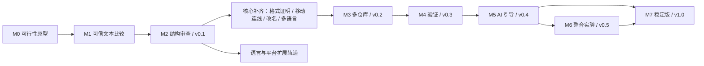

# Diffkin Roadmap

日期：2026-10-28。状态：**0.3.0-alpha.0，M3/M4 当前实现已进入集成验收**。M0–M2 和多语言核心的历史交付见 [alpha.2 核心验收](acceptance/core-languages.md)；本轮真实能力、限制及待补证据见 [M3/M4 验收记录](acceptance/m3-m4.md)。不把功能实现等同于全部产品退出条件通过。

先交付每天都能使用的降噪 diff，再围绕同一份变更集增加联合审查、验证、AI 和整合。每个里程碑必须留下可运行演示、真实语料与验收结果。按用户于 2026-10-28 的优先级调整，先补齐 M2 核心与 E1 多语言，再实现 M3、M4。该顺序已经落实；原生交互验收由用户暂缓，不阻塞当前工程实现。其他未通过的产品门槛继续明确记录。

## 1 交付顺序与原始工期假设

以下保留最初规划的工作量假设，不代表当前实际耗时或剩余交期。按一名熟悉 Rust / React 的全职开发者估算，包含阶段内测试和修复；不含学习成本、签名账户办理、长期用户反馈等待和扩展轨道。周数是工作量区间，不能直接当作交付日期。只有兼职投入时应按实际可用开发日重新换算。

| 阶段 | 建议投入 | 累计主线投入 | 可发布结果                      |
| ---- | -------- | ------------ | ------------------------------- |
| M0   | 1–2 周   | 1–2 周       | 技术原型与选型决定              |
| M1   | 2–3 周   | 3–5 周       | 内部可用的只读比较器            |
| M2   | 4–6 周   | 7–11 周      | v0.1 macOS Alpha，核心产品闭环  |
| M3   | 2–3 周   | 9–14 周      | v0.2，多仓库联合查看            |
| M4   | 3–4 周   | 12–18 周     | v0.3，可追溯的验证执行          |
| M5   | 4–6 周   | 16–24 周     | v0.4，AI 风险引导与首个契约关联 |
| M6   | 5–8 周   | 21–32 周     | v0.5，单仓库自动整合实验        |
| M7   | 3–5 周   | 24–37 周     | v1.0，已声明能力稳定发布        |

v1.0 以可信审查能力为门槛；M6 若未成熟，可继续作为实验功能或不随稳定版启用。跳过 M6 时主线投入约 19–29 周。多语言与跨平台投入另计，不能在单人计划中当作免费并行。

## 2 M0 验证技术与产品可行性

**演示：** 一个桌面窗口打开真实 Git 仓库，显示文件列表、双栏文本 diff 和一条结构移动关系；可以切文件和取消后台工作。

交付 Tauri / React / CodeMirror 原型、最小 Rust 内核和 CLI 调试入口；先对 TS 混合变更建立约 20 个种子案例。加入大文件、重复函数、语法错误和 Unicode/CRLF 案例，用于暴露技术风险。

退出条件：

- 在固定参考机器记录冷启动、首个文本结果、峰值内存、包体积、滚动与取消延迟，按[测量方法](quality.md)保存原始数据。
- CodeMirror 能承接自有对齐/折叠与移动关系，选择、搜索、复制和坐标转换保持正确。
- 验证解析器能协作取消；不能满足时试验独立分析进程，再确定运行结构。
- 验证 Vue SFC 分块与文本回退；确定系统 Git 最低兼容版本和检测方式。
- 写下首发平台、许可证、实际工具链版本及 M1 范围；若方案未达标，留下对比结果后调整选型。

**停止扩张条件：** 若单文件混合案例会丢失真实修改，或原型无法维持基本交互，则继续修复/简化 M0，不进入 AI、跨仓库推断或语言铺量。

## 3 M1 建立可信的只读比较器

**演示：** 对自己的一个真实提交完成审查，并能切换已暂存、未暂存和两个提交的比较。

交付快照、原始文本比较、分页文件列表、双栏/统一视图、搜索/复制/键盘导航、任务取消、文本回退、轻量会话恢复与 CLI JSON。模型从此支持 N 个仓库，UI 暂只暴露一个。

退出条件：

- UI 与 CLI 对相同输入产生相同的原始变化、来源身份和文件元数据。
- 源文件变化、分支移动、快速切换比较均不能污染已有结果；旧任务不会覆盖新比较。
- 二进制、文件模式、改路径、符号链接、子模块、LFS 指针、不可解码内容和 index 冲突均有明确呈现或降级。
- 不修改用户源码、index 和分支；不隐式执行仓库的脚本或外部 diff。
- 空仓库、浅克隆、Git 缺失、文件被删除、应用中断后仍能给出可理解的状态。

## 4 M2 交付结构审查与 v0.1

**演示：** 函数移动、局部变量改名、整文件格式化与 `>` → `>=` 同时出现；用户首先看到条件修改，也能查看移动和改名的证据。

范围：JS/TS 语法分析、保守格式折叠、文件内移动与内部编辑、受支持作用域中的局部改名、变更组、当前关系连线、Vue SFC 分块与脚本复用。首版不承诺跨文件符号改名、Vue 模板绑定或类型级行为推断。

退出条件：

- 冻结至少 80 个审校过的正确性 fixture，覆盖[反例矩阵](quality.md)；所有原始编辑都有覆盖处置，危险误折叠为零。
- 对已支持范围单独报告匹配精确率、召回率与降级比例；不能靠所有情况都回退来通过验收。
- 用户能解释“为什么折叠/为什么关联/哪里未分析”，并一键展开原始差异。
- 在 3 个真实项目的代表性提交中完成完整审查，收集至少 5 名试用者的可复现反馈；用户招募等待不计入开发周数。
- 满足 v0.1 性能门槛；生成 macOS 安装包、校验值、构建说明、第三方许可清单和已知限制。

**v0.1 范围锁定：** 桌面优先、只读、单仓库、JS/TS 优先；不附带模型权重，不启动项目语言服务器，不加入自动解冲突。

### 4.1 已完成的核心优先工作包（alpha.2）

以下工作已形成 alpha.2 核心实现，共用原始编辑覆盖与源码坐标契约；证据和仍未完成的产品门槛保留在历史报告：

- 语法内核：Python、Java、Go、Rust 与现有 JS/TS、Vue 脚本；安全空白/换行及受限冗余括号证明，混合修改只收起独立证明范围。
- 局部改名：参数/局部绑定按声明与引用位置成组；不确定作用域保留文本差异和降级原因。
- 审阅界面：当前移动关系连线、原位置跳转、父子变化分组与移动内部的精确对照。
- 语言显示与发布：各语言解析高亮、依赖许可增量、包体积与 CI 回归。

验收要求：各语言正反例、原始覆盖无缺口、危险语义变化保持可见；连线跟随滚动/布局与当前选择；展开后恢复原始内容。现已按此顺序进入 M3/M4；不将单纯安装 grammar 视为语言支持完成。

## 5 M3 多仓库联合查看：当前实现

**演示：** API、SDK、Web 三个仓库加入工作区，分别固定基线与候选，统一切换、标记审查、保存手工关联；删除或移动活动仓库后仍可恢复归档证据。

已实现稳定 repo ID 与路径映射、各仓 `ComparisonSpec`、不可变多仓快照、跨仓导航、手工关系、审查依据、历史恢复和默认不含源码/绝对路径/备注的摘要导出。缺失仓库局部报错，不阻塞其他仓库；未变化仓库保留身份上下文，**不保存全部未变化正文**。逐仓捕获没有全局原子保证。

持久化采用有界 JSON 而非 SQLite，限额与证据保留策略见[本轮验收](acceptance/m3-m4.md)。刷新创建新的 workspace snapshot，旧审查/关系不会直接继承；后端验证仓库、快照、文件、内容及 schema/rule，历史记录仍可追溯。

**工程回归已有证据：** 三仓同相对路径隔离、零变化上下文、缺失与重定位、移除活动源码后恢复、伪造依据拒绝、历史激活、容量/数量上限、原子失败和符号链接拒绝。具体针对性测试范围写入本轮报告。

**仍待验收或扩展：** 原生窗口实际操作、平台安装与资源测量、真实使用反馈、自动归档清理/迁移、SQLite 索引。自动跨仓影响/契约推断仍属于 M5；当前手工关系不表示语义兼容已证明。

## 6 M4 独立验证执行：当前实现

**演示：** 为单仓固定提交创建明确计划，用户核对并点击执行；显示日志、源码/程序/命令身份、依赖未确认状态及结果，再用同一计划运行基线对照。

已实现独立 validation crate、commit/tree 固定、包含未变化文件的完整提交装配、每次新运行副本、具体计划确认、Unix 可信本机执行、超时/取消、增量日志、历史结果、基线对照与启动恢复。测试程序修改捕获源码或执行程序变化时，结果不能被当成原版本通过。

当前范围有以下明确约束：

- 仅支持 **单仓 commit-only**，不验证 index/工作区输入，不装配跨仓 SDK 候选依赖。
- symlink/gitlink/LFS、声明 checkout 转换、不完整对象或文件系统别名碰撞不构成可执行的完整候选。
- Unix Adapter 是可信本机执行，**不是安全沙箱**；程序仍可访问主机与网络、主动脱离进程组。Windows 准备阶段返回 `Unsupported`，尚无执行 Adapter。
- 锁文件身份已记录，安装依赖、动态库、传递程序和完整工具链仍为 `unconfirmed`。单仓命令通过不等于多仓联合候选已验证。
- 正常退出使用 shutdown 门闩拒绝新作业、取消并等待当前作业清理；强制崩溃后只将遗留运行记录恢复为 `interrupted`，不重启命令、不杀旧 PID。
- 计划、副本、日志与生成物当前需要手动保留管理；没有自动总磁盘配额回收。容器/沙箱和 Windows 进程树支持留待后续。

结果可区分 `passed / failed / not-run / indeterminate / cancelled / interrupted / env-error` 与运行中状态。基线对照提供各自证据，不自动判断失败根因；历史通过也不应用到新计划或新源码。

**工程验收与产品退出条件分开：** 当前测试覆盖计划/内容/程序完整性、原仓不变、真实进程取消与超时、日志限额、锁和崩溃恢复。完整集成统计由本轮实际运行补录；原生操作、实际用户项目工具链、跨平台安装及资源测量仍待验收。原始 M4 中“依赖装配已确认”和跨仓联合验证尚未交付，不能随单仓 Adapter 完成而勾选。

## 7 M5 风险引导与首个跨仓库关联

**演示：** API 字段从 `name` 变为 `displayName`，SDK 与 Web 中还有旧引用。工具呈现相关证据、尚未确认的兼容前提，并引导运行对应检查。

交付一个云端和一个本地模型 Adapter、上下文选择与预算、结构化 Finding、根因去重、审查决策、OpenAPI 到 TS 调用方的首个关联切片，以及这三个仓库的候选依赖装配。先做好这个具体案例，再扩展协议和语言。

退出条件：

- 所有接受的代码引用都能定位到绑定快照；无效引用被拒收，推断与事实分别显示。
- 不启动 AI 时基础审查完整可用；超时、断网、无效 JSON、配额耗尽都不影响 diff。
- 用预留的评测案例人工标注可操作风险与误报；报告不同模型的结果，不用演示案例代替评测集。
- 源码中伪装成指令的文本不能触发命令执行、扩大上传范围或改写审查结果。
- 引导中的建议检查必须进入 M4 验证流程，不能由模型文本宣称已通过。

## 8 M6 自动整合实验

**演示：** 将一个线性提交系列 rebase 到新基线，产生一个冲突解法候选，明确显示解冲突带来的额外编辑，执行检查后由用户采纳。

交付 IntegrationAttempt 状态机、工具管理的候选工作区、Git 重放、模型解法、提交映射、候选间比较、恢复检查点与采纳为新分支的流程。更新已有分支在后续增加，不作为本实验首发要求。先覆盖单仓库；多仓库只联合复核候选，不承诺跨仓库原子更新。

退出条件：

- 用户原工作区不被解冲突过程覆盖；模型只能修改授权候选范围。
- 原系列改动与目标分支新增改动能够区分；每次模型修改有来源记录。
- 校验失败、应用崩溃、断网、取消和用户同时推进分支，都能停止并恢复。
- 最终采纳验证原 ref 与工作区前提，无授权不更新分支、不推送。
- Git 操作完成、检查通过、用户审查完成是三个独立状态；未覆盖项保持可见。

## 9 M7 稳定发布与扩展轨道

v1.0 收敛已发布功能，固定公开能力矩阵、协议版本策略、数据迁移和恢复说明。完成签名/公证或相应平台分发流程，CI 验证安装、升级、卸载与缓存清理；自动更新若启用，必须验证签名与升级路径。

稳定版最低要求是 macOS 上核心审查流程可靠；Windows / Linux 只在各自真实环境验收后标为稳定。M6 未通过全部退出条件时继续标实验，不阻塞只读审查发布。

| 扩展轨道          | 顺序与范围                                                                      | 额外工作量参考                        |
| ----------------- | ------------------------------------------------------------------------------- | ------------------------------------- |
| E1 多语言语法能力 | alpha.2 已实现 Python/Go/Rust/Java 的保守格式、移动与简单改名；深层符号仍待扩展 | 原估算 6–10 周，当前以能力矩阵为准    |
| E2 十余种语言覆盖 | HTML/CSS/JSON/YAML，再按使用需求增加 C/C++ 等；结构能力与文本支持分开计数       | 在 E1 后约 4–8 周，逐种评估           |
| E3 深层符号能力   | JS/TS 双版本项目上下文、跨文件改名；Vue script/template 绑定                    | 先做 1–2 周技术验证，再按实测拆分排期 |
| E4 桌面平台       | Windows 与 Linux 的 WebView、文件监视、取消进程树、路径与分发                   | 合计约 3–6 周；系统兼容问题另行评估   |

这些是扩展工作包，不是额外团队。E1 的初始范围已完成；后续语言、Windows 执行与沙箱需求仍需独立安排，保留核心正确性与证据边界。

语言支持按“文本 / 语法 / 局部符号 / 项目符号”逐项发布。Vue 还要单列分块、模板结构和跨块绑定；Rust 宏、Java 注解处理等未知区域明确回退。十余种语言目标不能用十余个 grammar 包已安装来代替验收。

## 10 第一轮开发任务

首轮任务状态如下；配置存在与远端 CI 实际通过分别记录：

- [x] 建立 Cargo / pnpm workspace，固定工具链和锁文件，采用 React、Rsbuild/Rspack、Oxlint/Oxfmt。
- [x] 提供三平台 CI、四目标发版构建、版本校验、SHA256SUMS 和 Release 草稿流程。
- [x] 建立公开 GitHub 仓库并接入 remote。
- [x] 实际跑通三平台 CI 和 tag 发版草稿（alpha.1 四目标产物及校验值验证通过）。
- [x] 建立 105 个明确 expected 的结构 fixture，以及组合与 Unicode 补充测试。
- [x] 实现无损文本、CLI JSON、CR/LF/CRLF 与 byte/UTF-16 位置索引。
- [x] 接入冻结的 Git 文件读取，跑通 commits/staged/unstaged/worktree 捕获。
- [x] 显示分页文件列表、双栏/统一只读 diff、选择、搜索、键盘切换与版本绑定审查标记。
- [x] 实现唯一顶层函数移动、简单局部改名、格式证明、内部修改对照与 Vue script 分块。
- [x] 打通任务 generation、排队/运行中取消、预算与迟到结果隔离。
- [x] 实现 M3 多仓库冻结会话、证据持久化、手工关联与摘要导出。
- [x] 实现 M4 单仓固定提交的可信 Unix 本机计划、执行、日志、取消与基线对照。
- [ ] 完成本轮全部集成记录、当前包体积和 CI 证据，不能复用旧版本成功状态。
- [ ] 补齐三类性能场景、全部进程内存和原生交互验收；用户暂缓项保持未验收。
- [ ] 核验真实依赖/工具链与跨仓候选装配，扩展 Windows/沙箱执行和存储回收。

## 11 风险与范围控制

| 风险                    | 处理方式                                | 触发收缩的条件                           |
| ----------------------- | --------------------------------------- | ---------------------------------------- |
| 结构匹配错误隐藏编辑    | 覆盖检查、规则证据、危险反例与原始切换  | 出现误折叠，暂停增加规则并修复已有范围   |
| 编辑器对齐成本过高      | M0 同时验证文本选择、搜索、折叠与长文档 | 正确性或交互预算不达标，调整显示实现     |
| 符号分析拖大基础包      | 局部能力先行，项目分析按需进程化        | 超过基础包/启动预算，拆为可选功能        |
| 多语言范围失控          | 每种语言独立能力矩阵与退出条件          | 没有反例语料和维护者，不宣称结构支持     |
| AI 噪声覆盖核心价值     | 有据可查、去重、按需运行、独立评测      | 风险无法定位或误报过多，缩小上下文与场景 |
| 跨仓库验证名不副实      | 核验实际依赖解析与候选摘要              | 无法证明使用候选，结果标为无法判断       |
| rebase 增加数据损失风险 | 候选隔离、检查点、ref 校验、人工采纳    | 恢复测试失败，保持实验且关闭自动应用     |

每个里程碑结束重新评估下一阶段工期，只调整未来范围。性能目标的调整必须保留原因和前后数据；正确性不变量不因排期放宽。
